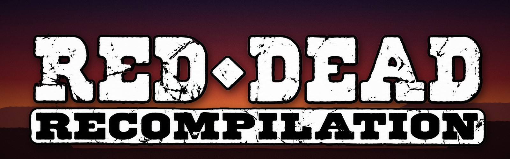

<div align="center">



### Red Dead Revolver (Xbox, 2004) running natively on PC

A static recompilation: the Xbox game's own code, translated ahead of time
into native PC code, with a modern launcher, settings, mouse and keyboard,
cheats, co-op and mods on top.


-b03a2e?style=flat-square&labelColor=1a1410)


[](https://discord.gg/u5MNF3FDfk)

**No game files included.** You need your own copy of the Red Dead Revolver
(USA) Xbox disc. Everything game-derived is made on your PC from it.

**[Watch the trailer on YouTube](https://www.youtube.com/watch?v=3C-nZWY-0F4)**

[](https://www.youtube.com/watch?v=3C-nZWY-0F4)

</div>

> [!IMPORTANT]
> **AI-assisted project.** Most of the code, tools and documentation here
> were written by AI coding agents (Anthropic's Claude models), directed
> and tested in-game by the maintainer. Expect bugs, and please report them
> (see [Reporting a problem](#reporting-a-problem)).

## What makes this port different

More than the game running on a PC: it adds things the Xbox game never had.

### 🌐 Online play, 2 to 4 players
Showdown and story co-op with a join code: at home, over a VPN such as
Tailscale, or over the internet with UDP port 27032 forwarded on the host's
router. Every player runs the whole game and only the controllers cross the
network, so every machine stays in step frame for frame, and each player
sees their own view. Hosted from the desk in the main menu, where the
Friends Menu was.

> ⚠️ **Highly experimental and still buggy.** Games can freeze or fall
> out of step. For now, to play together over the internet we
> recommend **local split-screen co-op shared through
> [Parsec](https://parsec.app)** (or Steam Remote Play Together): one
> PC runs the game and your friends join its screen with their own
> controllers.

### 👥 Story co-op for 2 to 4 players
Play the story together on one PC: shared screen, split screen, or **a
separate window for each player** (one per monitor). Each player picks
their own character, can keep their own weapons and money from chapter to
chapter, and opens their own menu. Duels can be fought by every player at
once.

### 🤠 Play as anyone, in the story and in Showdown
Any Showdown character can play the story (**Play As**). The Showdown
line-up has room for **up to 400 characters over 8 pages**: the game's own
48 and up to 352 new ones. The optional extras (launcher > Extras) fill 115
of those places: 59 of the story's own people (Brimstone's townsfolk,
Jesse Lynch, Katie O'Grady, Colonel Darren, Atlas and more) and 56 of the
2002 preview's characters, 163 in all over 4 pages. The rest of the room
is there for mods.

### 🗂️ The lost 2002 preview, playable
The January 2002 PS2 preview (the
[15 January 2002 build preserved by Hidden Palace](https://hiddenpalace.org/Red_Dead_Revolver_%28Jan_15,_2002_prototype%29)) had characters
and levels that never shipped. Point the launcher at your own copy of it and
**56 of its characters** (an early Red, a long-coat Red, Pig Josh, Bat Boy
who flies...) and **31 of its stages** (an unreleased mine, deathmatch
arenas) join Showdown and Play As. The stages are ported as they are on
that early disc, unfinished: some may not work properly as Showdown
stages. And the **2002 look** gives the HUD and
pause menu the preview's style (the TIME clock, the revolver's rounds in
an arc, the red Dead Eye badge, the curved blue bands) from art still
on the retail disc.

### 🧨 A live spawner
From the in-game menu, make anyone in the level right now: any character,
acting like anyone from **any chapter** (their AI comes with them), on
your side or against you, armed or not, with a boss's health bar if you
like, or a herd of another chapter's cattle. Bring in the level's own
people, hand out any of the game's weapons, refill ammunition.

### 🔫 Guns in Brimstone
The story keeps your guns holstered in town. Switch on **Guns in Town**
and draw anywhere (the streets, the saloon, the stores) with
townsfolk who can be hurt and who come back a minute later.

### 🎥 And more
A free camera, chapter select from the pause menu, the game's own cheats
without unlocking them plus new ones (infinite ammo, always win duels,
freeze people), mouse aim even in duels, and sharp text.

## The basics

| | | |
| :--- | :--- | :--- |
| 🖥️ **Native PC build** from your own disc, no emulator | 📐 **Widescreen**, any window size, up to 6x internal resolution, FXAA, anisotropic filtering | 🎞️ **High frame rates**: 30, 60, 120, 144, 165, 240 or unlimited |
| 🎮 **Any controller** through SDL2: Xbox, DualSense, DualShock 4, Switch Pro | 🖱️ **Mouse and keyboard** with direct mouse aim, every key rebindable | 🔤 **Sharp text**: the game's lettering drawn four times finer |
| ⚙️ **A launcher and in-game menus** drawn in the game's own style | 🧰 **Mods**: file replacements, texture packs, new stages and characters, each on or off in the launcher | 📼 **Replacement movies** and upscaled texture packs |

## Getting started

### What you need

- Your own **Red Dead Revolver (USA)** Xbox disc, extracted (`default.xbe`,
  `swat.dat`, `bik\`, ...) or as a disc image (`.iso`).
- **Windows 10 or 11, 64-bit**. (Linux builds too; its renderer is less
  complete. See [BUILDING.md](docs/BUILDING.md#linux).)
- A graphics card with OpenGL 3.3 (anything from the last decade).
- **Recommended:** a recent 4-core (or more) desktop or laptop processor
  and 8 GB of RAM. The game emulates the Xbox's graphics and sound chips
  as it runs, which is heavy work: low-power chips such as the Intel
  N100/N200 with 4 GB of RAM build and run it, but with broken-up sound
  and stutters. On a slower PC, a 30 fps cap and 1x resolution help.
- About **15 GB free** if you have none of the tools yet (about **12 GB**
  if Visual Studio's C++ tools are already installed; about 2 GB more for
  the optional extras; details below), and 30-60 minutes for the first
  build.

### What the build downloads, and the space it takes

`build.bat` checks for each of these and offers to install what is missing;
nothing is installed without asking. Sizes are approximate. Visual Studio is
installed slim: the compiler and the Windows SDK, without the C++ workload's
recommended extras and without keeping the installer's download cache. (Have
the full "Desktop development with C++" already? It works as it is; the
Visual Studio Installer's Modify can remove the extras.)

| Prerequisite | What it is for | Download | On disk |
| :--- | :--- | ---: | ---: |
| [Visual Studio 2022 Build Tools](https://visualstudio.microsoft.com/downloads/#build-tools-for-visual-studio-2022): only the C++ compiler (MSVC x64) and the Windows SDK | the C/C++ compiler | ~1.5-2 GB | ~3-4 GB |
| [Git for Windows](https://git-scm.com/download/win) | fetching the toolkit | ~65 MB | ~350 MB |
| [Python 3.12](https://www.python.org/downloads/) (3.10 or newer) | translating the game's code, the setup tools | ~25 MB | ~110 MB |
| capstone (Python package) | the disassembler the translation uses | ~1.3 MB | ~5 MB |
| CMake (Python package, only if Visual Studio's own is not there) | the build's project files | ~50 MB | ~100 MB |
| [xboxrecomp](https://github.com/sp00nznet/xboxrecomp) toolkit | the recompiler and Xbox runtime | ~5 MB | ~180 MB |
| [SDL2](https://github.com/libsdl-org/SDL) 2.30.9 | controllers | ~3 MB | ~22 MB |

**Smaller, without Visual Studio:** the first build asks which compiler
to use. Choose **2** (or run `build.bat -Compiler clang`) to build with [LLVM-MinGW](https://github.com/mstorsjo/llvm-mingw)
instead: Clang and the Windows headers and libraries in one folder, no
installer and no admin prompt. It replaces the Visual Studio row above:

| Instead of Visual Studio | What it is for | Download | On disk |
| :--- | :--- | ---: | ---: |
| [LLVM-MinGW](https://github.com/mstorsjo/llvm-mingw) 20250826 (UCRT, x86_64) | the C/C++ compiler | ~175 MB | ~600 MB |
| CMake and Ninja (Python packages) | the build's project files and running it | ~55 MB | ~110 MB |
| SDL2's MinGW package | controllers | ~8 MB | ~30 MB |

That makes about **12 GB free** in all, instead of 15. The same is offered when Visual
Studio is missing and you say no to installing it.

What the build and the game make:

| | On disk |
| :--- | ---: |
| Your game files (the extracted disc; from an `.iso` the build unpacks them, the image itself is only read) | ~3 GB |
| The translated C code and the compile (`src\recomp\gen\`, `build\`) | ~250 MB |
| The play folder (the game program, settings, logs) | ~50 MB |
| Saves (`Saves\`: the game's save files and its virtual Xbox hard disk, which can grow) | up to ~6 GB |
| Online play: a copy of the host's save and the game's cache (`Saves\Online\`) | up to ~0.7 GB |
| *Optional:* the story's people (launcher > Extras) | ~0.4 GB |
| *Optional:* the 2002 preview characters (launcher > Extras; needs 2 GB free while it runs, and installs numpy and Pillow for Python, ~20 MB) | ~1.3 GB, plus the story's people |

### Build and play (Windows)

1. Download the latest release from the
   [Releases](https://github.com/DallasXC/red-dead-recompilation/releases)
   page (**Source code (zip)**), unzip it, and put the folder (any name)
   next to your extracted disc:

   ```
   <anywhere>\rdr-recomp\                   this project
   <anywhere>\Red Dead Revolver (USA)\      default.xbe, swat.dat, bik\, ...
   ```

   Only have the disc image (`.iso`)? Skip this: drop the `.iso` onto
   **`build.bat`** (or run it and pick the image in the window it opens),
   and it unpacks the disc there for you. Extracted somewhere else, or
   under another name? Pick that folder's `default.xbe` in the same window
   (or drop the folder onto `build.bat`).

2. Double-click **`build.bat`**. It offers to install anything missing
   (Git, Python 3, Visual Studio 2022's C++ tools), fetches the
   [xboxrecomp](https://github.com/sp00nznet/xboxrecomp) toolkit, turns your
   `default.xbe` into C (about 15 minutes) and compiles it (10-30 minutes).
   Running it again only redoes what changed.
3. Play from the **Red Dead Recompilation** folder it makes inside the
   project: start **Red Dead Revolver.exe**.

The launcher (settings) opens before the game; switch that off on its
About page, and hold **Shift** while the game starts to see it again.
**F1** (or both sticks clicked) opens the in-game menu. Full instructions:
[docs/USER_GUIDE.md](docs/USER_GUIDE.md). Building by hand, or on Linux:
[docs/BUILDING.md](docs/BUILDING.md).

### Tutorial: the story's people as playable characters

The story's own people (the townsfolk, shopkeepers, soldiers, Jesse
Lynch, Katie O'Grady, Colonel Darren, Atlas and the rest) can be
Showdown characters and Play As choices. They are made from your own game
files, so there is nothing else to get.

1. Start **Red Dead Revolver.exe**; the launcher opens (if it no longer
   does, hold **Shift** while the game starts).
2. Go to **Extras** and choose **Set up the story's people**. It takes a
   few minutes and shows its progress; when it says **Done** they are on.
3. Press **Play**. In **Showdown**, push the hand past the right edge of
   the line-up photo (or click the arrows) to turn to their page, and pick
   one as you would any character.
4. In the **story**: press **F1** (or click both sticks) > **Play As**, or
   use the chapter book's Play As; pick one and start or restart a
   chapter. In story co-op, **Player 2-4 as** offers the same list.

### Tutorial: the 2002 preview characters

You need a disc image (`.iso`) of the January 2002 PS2 preview, the
15 January 2002 build (see
[Hidden Palace's page about it](https://hiddenpalace.org/Red_Dead_Revolver_%28Jan_15,_2002_prototype%29)).
It is not included: use your own copy. You also need about 2 GB free. This setup brings the
story's people too, so the tutorial above is not needed as well.

1. In the launcher, go to **Extras** and choose **Set up the preview
   characters**.
2. Pick the preview's disc image in the window that opens. The setup runs
   by itself (5-10 minutes); the image is only read, and everything made
   goes into `Mods\Preview\`.
3. When it says **Done**, press **Play**. In Showdown the preview's
   characters are on the line-up's next page, and its stages in the stage
   list (marked (2002) where a retail stage has the same name). In the
   story they are in **Play As**, after the game's own characters.
4. Switch them off or on any time: launcher > Extras > **Preview
   characters**. Your saves are the same either way.

When an update changes these characters, the launcher's Extras page says
the setup is out of date: choose it again to bring them up to date.

### Tutorial: making people on the spot (the spawner)

1. In a chapter, press **F1** > **All PC Options** > **Spawner**, down to
   **New people**.
2. Pick a **Character** (this level's people, another chapter's animals,
   or anyone in the Play As list) and how they **Act**: like one of this
   level's people or, further down the list, like someone from another
   chapter.
3. Choose their **Side**, **How many**, **Where**, **Guns** and whether
   they get a **Health bar**, then **Make**. **Remove the people made**
   takes them away again.

Someone from another chapter may need paths or scripts this level does
not have: if they just stand there, try another way of acting.


## Documentation

| Document | For |
|---|---|
| [docs/USER_GUIDE.md](docs/USER_GUIDE.md) | players: the play folder, controllers, launcher, mouse and keyboard, menus, cheats, co-op, hotkeys, troubleshooting |
| [docs/BUILDING.md](docs/BUILDING.md) | building on Windows (one click or by hand) and Linux, the toolkit patch, the project's layout |
| [docs/MODDING.md](docs/MODDING.md) | the mods folder, texture packs, new Showdown stages and characters, the 2002 preview |
| [docs/ONLINE.md](docs/ONLINE.md) | online co-op: how it works and where it stands |
| [docs/dev/BRINGUP.md](docs/dev/BRINGUP.md) | developers: the development log, every fix and why |
| [CHANGELOG.md](CHANGELOG.md) | what the port can do, by area |
| [CONTRIBUTING.md](CONTRIBUTING.md) | reporting problems and contributing |

## Good to know

| Key | What |
|---|---|
| F1, or both sticks clicked | Quick menu: cheats, co-op, settings |
| F2 | frame counter |
| F6 | free camera |
| F11 or Alt+Enter | fullscreen |
| Shift held at start | the launcher (settings), once it no longer opens every time |

- **Saves** go to `Saves\` in the play folder, **mods** to `Mods\`,
  **settings** to `settings.ini`. Each start that finds the saves changed
  copies them to `Saves\Backup\1` first (the two copies before it are kept
  as `2` and `3`).
- **Network**: the launcher asks GitHub once a start whether there is a
  newer release (nothing is downloaded or installed; it only shows a link).
  Switch it off with **Check for updates** on the launcher's About page.
  Nothing else goes online unless you host or join an online game.
- **Uninstalling**: everything the port makes is in the project folder:
  the play folder (**Red Dead Recompilation**: the program, `Game\`,
  `Saves\`, `Mods\`, `Logs\`, `settings.ini`) and the build's own folders
  (`deps\`, `build\` or `build-clang\`, `src\recomp\gen\`). Copy `Saves\`
  somewhere if you want to keep your progress, then delete the project
  folder. Nothing goes in the registry, AppData or the Start menu. Outside
  it is only what the build installed when you said yes: Visual Studio
  Build Tools, Git and Python (Windows' Settings > Apps), and Python
  packages for your user (`python -m pip uninstall capstone cmake ninja
  numpy pillow`). If the play folder could not be written, the log went to
  `%TEMP%\Red Dead Recompilation last_run.log`.
- **Known rough edges**: story co-op is experimental and online co-op is
  highly experimental (for now, split screen through Parsec is the
  reliable way to play together over the internet);
  high frame rates are new (if something looks wrong, go back to 60); the
  Linux renderer is behind the Windows one.

### Reporting a problem

Each start writes `Logs\last_run.log` in the play folder (the one before
it is kept as `previous_run.log`). Open an issue with the log attached and
what you were doing; a short video helps a lot. See
[CONTRIBUTING.md](CONTRIBUTING.md).

For questions, help getting it running, and to share what you make, join
the **[Discord server](https://discord.gg/u5MNF3FDfk)**. Bugs are best reported as issues here,
so they are not lost.

## How it works

[xboxrecomp](https://github.com/sp00nznet/xboxrecomp) disassembles the Xbox
executable and lifts every function to C; this project compiles that C
with a runtime standing in for the Xbox's kernel, GPU, audio and
controllers. On top sit this game's fixes and features, keyed by the
addresses of the game's own functions: `src/rdr_overrides.c` and
`src/rdr_hooks.c` (fixes, cheats, co-op), `src/ui/` (the launcher, the
in-game menus, mouse and keyboard), `src/net/` and `src/rdr_lockstep.c`
(online play). The development log, [docs/dev/BRINGUP.md](docs/dev/BRINGUP.md),
tells the whole story fix by fix.

## Credits

- **[xboxrecomp](https://github.com/sp00nznet/xboxrecomp)** by sp00nz: the
  recompilation toolkit and Xbox runtime this port is built on (MIT).
- **[red-dead-revolver-pc](https://github.com/dennisabalo18-bot/red-dead-revolver-pc)**
  by dennisabalo18-bot, another PC port of the game. Two things here
  come from that project's work: the stuck-controls safeguard (when a
  controller's reports stop reaching the game, it is read straight from
  the PC instead of the player walking on with the controls dead, a
  problem that project found and fixed first) and the idea of replacement
  cutscene movies. Thank you!
- The MCPX audio and NV2A graphics emulation in xboxrecomp follows
  [xemu](https://github.com/xemu-project/xemu) (its licences are listed in
  xboxrecomp).
- Libraries: [Dear ImGui](https://github.com/ocornut/imgui) (MIT),
  [stb](https://github.com/nothings/stb) (MIT / public domain),
  [SDL2](https://github.com/libsdl-org/SDL) (zlib, downloaded at build time),
  [Capstone](https://github.com/capstone-engine/capstone) (BSD, used by the
  build). Fonts: Berylium by Ray Larabie (Larabie Fonts freeware), Rye and IM
  Fell (SIL Open Font License). Details: [THIRD_PARTY_NOTICES.md](THIRD_PARTY_NOTICES.md).

## Licence

This project's own code, scripts and documentation are under the **MIT
licence** ([LICENSE](LICENSE)). It does not cover Red Dead Revolver or
anything made from your copy of it (the generated code in
`src/recomp/gen/`, mods made by the tools, extracted textures). Third-party
parts keep their licences ([THIRD_PARTY_NOTICES.md](THIRD_PARTY_NOTICES.md));
the toolkit patch's changes to two of xboxrecomp's LGPL files (from xemu) are
under the LGPL-2.1-or-later ([LICENSES/LGPL-2.1.txt](LICENSES/LGPL-2.1.txt)).

## Legal

This is an unofficial fan project, not affiliated with or endorsed by
Rockstar Games, Take-Two Interactive or Microsoft. *Red Dead Revolver* is a
trademark of Take-Two Interactive; Xbox is a trademark of Microsoft. No game
code or assets are distributed: you must supply your own legally obtained
copy of the game. The code generated from it (`src/recomp/gen/`) and files
made from your copy (mods, extracted textures) contain game-derived data
and must not be shared. The repository holds only identifiers taken from
the game (the names of some of its functions (`names/`), its characters'
codes and its levels' AI table names) not its code or content.
